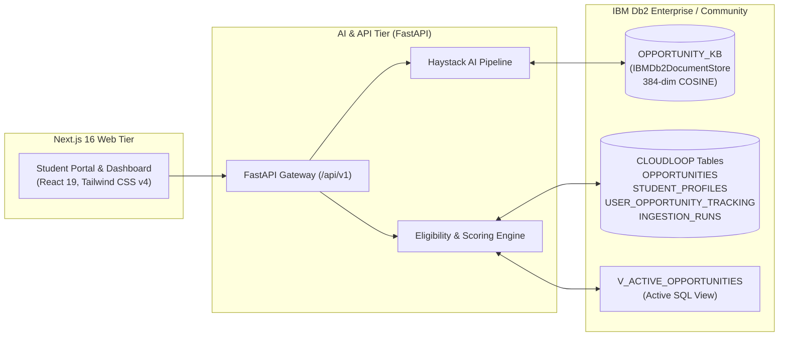

# Cloud Loop ⚡

> **AI-Powered Student Opportunity Intelligence Platform**  
> *Official Hackathon Submission for IBM Db2 TechX Summit 2026 @ GL Bajaj, Mathura*  
> Built with IBM Db2, Haystack AI (`ibm-db-haystack`), FastAPI, Next.js 16, and React 19.

[](https://www.ibm.com/products/db2)
[](https://haystack.deepset.ai/)
[-black?style=for-the-badge&logo=next.js)](https://nextjs.org/)
[](https://fastapi.tiangolo.com/)
[](https://react.dev/)

---

## 👥 Team Information

- **Solo Builder**: Ayush Sharma ([@Ayushh-Sharmaa](https://github.com/Ayushh-Sharmaa))
- **Role**: Software Architect, Full-Stack & IBM Db2 AI Engineer
- **Institution**: GL Bajaj Institute of Technology and Management
- **Event**: IBM Db2 TechX Summit 2026 Hackathon

---

## 📌 Problem Statement

Students in tech colleges routinely miss premier career programs (such as the *Google Cloud Arcade Facilitator Program*, *Microsoft Learn Student Ambassadors*, *GitHub Campus Experts*, enterprise internships, and tier-1 hackathons) due to fragmented information across Discord servers, LinkedIn feeds, and unindexed corporate boards.

Traditional opportunity boards suffer from:
1. **Keyword Rigidity**: Keyword filters fail to match intent (e.g., searching for "AI engineer" misses "Applied Deep Learning Trainee").
2. **Eligibility Blindness**: Students spend hours applying to programs only to be rejected over undisclosed year or batch constraints.
3. **No Explainability**: Black-box ranking gives no indication why an opportunity is recommended or how to qualify.

---

## 💡 Solution & Key Features

**Cloud Loop** bridges this gap using IBM Db2 as the single source of truth for both semantic vector discovery and relational integrity:

1. **Haystack + IBM Db2 Vector Knowledge Base (`OPPORTUNITY_KB`)**:
   - Stores dense 384-dimensional vector embeddings with cosine distance calculation directly in IBM Db2.
   - Natural language semantic search powered by `sentence-transformers/all-MiniLM-L6-v2`.
2. **Relational Opportunity Management (Schema `CLOUDLOOP`)**:
   - Normalized relational tables storing 3,800+ student opportunities, student profiles, application tracking, and ingestion runs.
   - SQL view `V_ACTIVE_OPPORTUNITIES` for instant deadline-based filtering.
3. **Multi-Factor Student Matching Engine**:
   - Composite matching score combining semantic affinity (50%), skill overlap (30%), and domain interest (20%).
   - Hard eligibility verification against graduation batch, degree, and study year.
4. **Transparent Match Explanations**:
   - Generates human-readable, auditable rationales explaining exact qualification factors for every recommended role.
5. **Zero-Friction Evaluation (`AUTH_MODE=demo`)**:
   - Instant live evaluation mode pre-seeded with verified opportunities and a demo student profile without requiring third-party credentials.

---

## 🏛️ System Architecture



---

## 💾 IBM Db2 Integration Depth

### Database Entities & DDL

```sql
CREATE SCHEMA CLOUDLOOP;

-- 1. Master Opportunities
CREATE TABLE CLOUDLOOP.OPPORTUNITIES (
    ID                  VARCHAR(128)    NOT NULL PRIMARY KEY,
    SLUG                VARCHAR(256)    NOT NULL UNIQUE,
    TITLE               VARCHAR(256)    NOT NULL,
    ORGANIZATION        VARCHAR(256)    NOT NULL,
    OPPORTUNITY_TYPE    VARCHAR(64)     NOT NULL,
    CATEGORY            VARCHAR(64)     NOT NULL,
    DESCRIPTION         CLOB,
    LOCATION            VARCHAR(256),
    LOCATION_TYPE       VARCHAR(32),
    SKILLS              CLOB,
    ELIGIBILITY         CLOB,
    DEADLINE            VARCHAR(64),
    APPLICATION_URL     VARCHAR(1024)   NOT NULL,
    SOURCE_NAME         VARCHAR(64)     DEFAULT 'CloudLoop Curated',
    SOURCE_URL          VARCHAR(1024),
    VERIFICATION_STATUS VARCHAR(32)     DEFAULT 'VERIFIED',
    FETCHED_AT          TIMESTAMP       DEFAULT CURRENT TIMESTAMP,
    CREATED_AT          TIMESTAMP       DEFAULT CURRENT TIMESTAMP,
    UPDATED_AT          TIMESTAMP       DEFAULT CURRENT TIMESTAMP
);

-- 2. Student Profiles
CREATE TABLE CLOUDLOOP.STUDENT_PROFILES (
    USER_ID             VARCHAR(128)    NOT NULL PRIMARY KEY,
    EDUCATION           VARCHAR(256),
    DEGREE              VARCHAR(128),
    STUDY_YEAR          INT             DEFAULT 1,
    GRADUATION_BATCH    VARCHAR(32),
    SKILLS              CLOB,
    INTERESTS           CLOB,
    PREFERRED_DOMAINS   CLOB,
    PREFERRED_LOCATIONS CLOB,
    UPDATED_AT          TIMESTAMP       DEFAULT CURRENT TIMESTAMP
);

-- 3. Tracking & Pipeline
CREATE TABLE CLOUDLOOP.USER_OPPORTUNITY_TRACKING (
    USER_ID             VARCHAR(128)    NOT NULL,
    OPPORTUNITY_ID      VARCHAR(128)    NOT NULL,
    APPLICATION_STATUS  VARCHAR(64)     DEFAULT 'BOOKMARKED',
    BOOKMARKED          SMALLINT        DEFAULT 1,
    UPDATED_AT          TIMESTAMP       DEFAULT CURRENT TIMESTAMP,
    PRIMARY KEY (USER_ID, OPPORTUNITY_ID),
    CONSTRAINT FK_TRACK_OPP FOREIGN KEY (OPPORTUNITY_ID) 
        REFERENCES CLOUDLOOP.OPPORTUNITIES(ID) ON DELETE CASCADE
);

-- 4. Ingestion Run Audit
CREATE TABLE CLOUDLOOP.INGESTION_RUNS (
    ID                  VARCHAR(64)     NOT NULL PRIMARY KEY,
    SOURCE              VARCHAR(64)     NOT NULL,
    RECORDS_PROCESSED   INT             DEFAULT 0,
    RECORDS_INSERTED    INT             DEFAULT 0,
    RECORDS_UPDATED     INT             DEFAULT 0,
    RECORDS_REJECTED    INT             DEFAULT 0,
    STATUS              VARCHAR(32)     DEFAULT 'SUCCESS',
    STARTED_AT          TIMESTAMP       DEFAULT CURRENT TIMESTAMP,
    COMPLETED_AT        TIMESTAMP       DEFAULT CURRENT TIMESTAMP
);

-- 5. Active View
CREATE VIEW CLOUDLOOP.V_ACTIVE_OPPORTUNITIES AS
SELECT * FROM CLOUDLOOP.OPPORTUNITIES
WHERE DEADLINE IS NULL OR DEADLINE = 'Ongoing' OR DEADLINE >= VARCHAR_FORMAT(CURRENT TIMESTAMP, 'YYYY-MM-DD');
```

---

## 🚀 Quickstart & Reproducibility Guide

You can run the entire Cloud Loop platform using Docker Compose in under 5 minutes without any third-party accounts.

### Prerequisites
- Docker Engine & Docker Compose
- Or Python 3.10+ and Node.js 18+ for local native execution

### Option A: Complete Docker Compose (Recommended)

```bash
# 1. Clone the repository
git clone https://github.com/Ayushh-Sharmaa/Cloud-Loop.git
cd Cloud-Loop

# 2. Launch IBM Db2, AI Service, and Next.js Web
docker compose up -d

# 3. Seed IBM Db2 with curated opportunity and vector datasets
docker compose exec ai-service python scripts/seed_db2.py

# 4. Open the Web Application
# Navigate to http://localhost:3000 in your browser
```

### Option B: Local Development Setup

```bash
# 1. Backend AI Service
cd src/ai-service
pip install -r requirements.txt
python scripts/seed_db2.py
uvicorn main:app --port 8000 --reload

# 2. In a separate terminal, launch the Frontend
cd src/web
npm install
npm run dev
# App will run at http://localhost:3000
```

---

## 🧪 Testing & Verification Evidence

All tests execute with standard `pytest` and Next.js test commands:

```bash
# Run AI Service & Db2 test suite (12/12 passing)
cd src/ai-service
python -m pytest tests -v

# Run Frontend Type & Build Verification
cd src/web
npx tsc --noEmit
npm run build
```

**Test Verification Matrix**:
| Test Suite | Purpose | Status |
| :--- | :--- | :--- |
| `test_haystack_db2.py` | IBMDb2DocumentStore vector search & filtering | ✅ PASSED |
| `test_eligibility.py` | Student academic & deadline criteria evaluation | ✅ PASSED |
| `test_opportunities.py` | Paginated catalog retrieval & filtering | ✅ PASSED |
| `test_recommendations.py` | Multi-factor weighted match engine & rationale | ✅ PASSED |
| `test_ingestion.py` | Secure batch ingestion and provenance auditing | ✅ PASSED |
| `test_health.py` | System health check & Db2 connection diagnostics | ✅ PASSED |
| Next.js Static Build | 28 production routes generated with zero errors | ✅ PASSED |

---

## 📜 Submission Metadata

- **Submission Slug**: `cloud-loop`
- **Submission Schema**: Validated against official IBM Db2 TechX Summit JSON schema
- **License**: MIT
