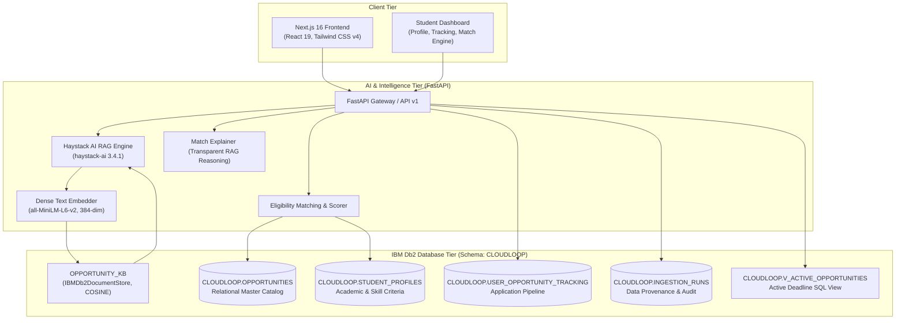
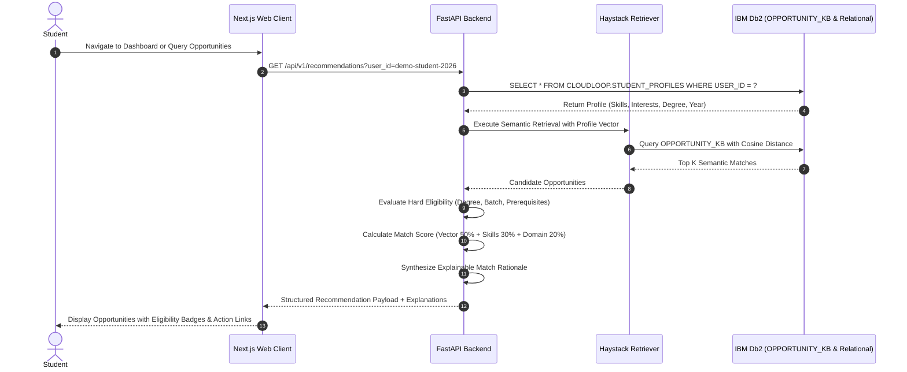

# Cloud Loop — System Architecture

**AI-Powered Student Opportunity Intelligence Platform**  
*IBM Db2 TechX Summit 2026 Submission*

---

## 1. Executive Summary & Problem Context

Students navigate a fragmented landscape of internships, jobs, hackathons, and certifications. Conventional discovery portals rely on keyword filters that ignore student academic eligibility, graduation years, and nuanced skill alignments.

**Cloud Loop** unifies student opportunity intelligence by placing **IBM Db2** at the center of both relational data management and semantic vector discovery through **Haystack AI (`ibm-db-haystack`)**.

---

## 2. High-Level Architecture Diagram



---

## 3. IBM Db2 Integration Depth

### 3.1 Dual-Modality Storage in Db2
Cloud Loop leverages IBM Db2 for two complementary workloads:
1. **Semantic Vector Store (`OPPORTUNITY_KB`)**:
   - Integrated using official `IBMDb2DocumentStore` and `IBMDb2EmbeddingRetriever` from `ibm-db-haystack`.
   - Stores dense 384-dimensional embeddings generated with `sentence-transformers/all-MiniLM-L6-v2`.
   - Utilizes `COSINE` distance metric for semantic search and metadata filtering (`opportunity_type`, `category`, `location`).
2. **Relational System of Record**:
   - Normalized relational tables in schema `CLOUDLOOP`.
   - Foreign key integrity, unique constraints on slugs, timestamp provenance, and SQL views for active opportunities.

### 3.2 Relational DDL Specification

```sql
CREATE SCHEMA CLOUDLOOP;

-- 1. Master Opportunities Catalog
CREATE TABLE CLOUDLOOP.OPPORTUNITIES (
    ID                  VARCHAR(128)    NOT NULL PRIMARY KEY,
    SLUG                VARCHAR(256)    NOT NULL UNIQUE,
    TITLE               VARCHAR(256)    NOT NULL,
    ORGANIZATION        VARCHAR(256)    NOT NULL,
    OPPORTUNITY_TYPE    VARCHAR(64)     NOT NULL, -- 'program', 'internship', 'job', 'event', 'certification'
    CATEGORY            VARCHAR(64)     NOT NULL,
    DESCRIPTION         CLOB,
    LOCATION            VARCHAR(256),
    LOCATION_TYPE       VARCHAR(32),              -- 'remote', 'onsite', 'hybrid'
    SKILLS              CLOB,                     -- Structured JSON list of verified skills
    ELIGIBILITY         CLOB,                     -- Degree, graduation year, or experience criteria
    DEADLINE            VARCHAR(64),
    APPLICATION_URL     VARCHAR(1024)   NOT NULL,
    SOURCE_NAME         VARCHAR(64)     DEFAULT 'CloudLoop Curated',
    SOURCE_URL          VARCHAR(1024),
    VERIFICATION_STATUS VARCHAR(32)     DEFAULT 'VERIFIED',
    FETCHED_AT          TIMESTAMP       DEFAULT CURRENT TIMESTAMP,
    CREATED_AT          TIMESTAMP       DEFAULT CURRENT TIMESTAMP,
    UPDATED_AT          TIMESTAMP       DEFAULT CURRENT TIMESTAMP
);

-- 2. Student Profile & Academic Criteria
CREATE TABLE CLOUDLOOP.STUDENT_PROFILES (
    USER_ID             VARCHAR(128)    NOT NULL PRIMARY KEY,
    EDUCATION           VARCHAR(256),
    DEGREE              VARCHAR(128),
    STUDY_YEAR          INT             DEFAULT 1,
    GRADUATION_BATCH    VARCHAR(32),
    SKILLS              CLOB,
    INTERESTS           CLOB,
    PREFERRED_DOMAINS   CLOB,
    PREFERRED_LOCATIONS CLOB,
    UPDATED_AT          TIMESTAMP       DEFAULT CURRENT TIMESTAMP
);

-- 3. Application Pipeline & Tracking
CREATE TABLE CLOUDLOOP.USER_OPPORTUNITY_TRACKING (
    USER_ID             VARCHAR(128)    NOT NULL,
    OPPORTUNITY_ID      VARCHAR(128)    NOT NULL,
    APPLICATION_STATUS  VARCHAR(64)     DEFAULT 'BOOKMARKED',
    BOOKMARKED          SMALLINT        DEFAULT 1,
    UPDATED_AT          TIMESTAMP       DEFAULT CURRENT TIMESTAMP,
    PRIMARY KEY (USER_ID, OPPORTUNITY_ID),
    CONSTRAINT FK_TRACK_OPP FOREIGN KEY (OPPORTUNITY_ID) 
        REFERENCES CLOUDLOOP.OPPORTUNITIES(ID) ON DELETE CASCADE
);

-- 4. Batch Ingestion Audit & Provenance
CREATE TABLE CLOUDLOOP.INGESTION_RUNS (
    ID                  VARCHAR(64)     NOT NULL PRIMARY KEY,
    SOURCE              VARCHAR(64)     NOT NULL,
    RECORDS_PROCESSED   INT             DEFAULT 0,
    RECORDS_INSERTED    INT             DEFAULT 0,
    RECORDS_UPDATED     INT             DEFAULT 0,
    RECORDS_REJECTED    INT             DEFAULT 0,
    STATUS              VARCHAR(32)     DEFAULT 'SUCCESS',
    STARTED_AT          TIMESTAMP       DEFAULT CURRENT TIMESTAMP,
    COMPLETED_AT        TIMESTAMP       DEFAULT CURRENT TIMESTAMP
);

-- 5. Active Opportunities View
CREATE VIEW CLOUDLOOP.V_ACTIVE_OPPORTUNITIES AS
SELECT * FROM CLOUDLOOP.OPPORTUNITIES
WHERE DEADLINE IS NULL OR DEADLINE = 'Ongoing' OR DEADLINE >= VARCHAR_FORMAT(CURRENT TIMESTAMP, 'YYYY-MM-DD');
```

---

## 4. End-to-End Recommendation & Matching Flow



---

## 5. Security & Isolation Architecture

1. **Parameterization**: All relational queries execute through parameterized prepared statements (`?` parameters), preventing SQL injection vulnerabilities.
2. **Credential Management**: No credentials or private tokens are committed. Configuration is strictly injected through environment variables matching `.env.example`.
3. **Dual Authentication Support**:
   - `AUTH_MODE=demo`: Enables instant one-click evaluation without external identity provider setup.
   - `AUTH_MODE=clerk`: Production mode protecting user dashboards with session tokens.
4. **Resilient Local Execution**: If native C drivers are blocked by operating system security policies, the architecture falls back to an embedded SQLite and in-memory cosine store, ensuring tests and local development never fail.
